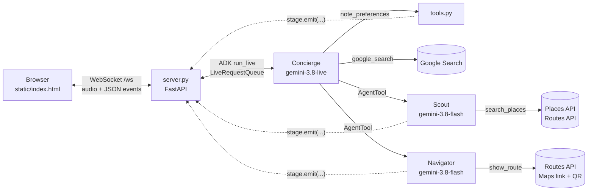

# Dinner Scout: a tour of the code

This is for anyone who wants to see how the app fits together: an instructor taking a two-minute look at the
code on stage, or an attendee who wants to build something like it. The first part maps every file in the repo.
The second follows one conversation from the mic to the QR code and names the function that handles each step.
The last part lists the few places worth pointing at on screen.

For running the demo, see [README.md](README.md) and [STAGE.md](STAGE.md). This page is only about the code.

## The idea in one paragraph

The browser talks to one small Python server (FastAPI) over a WebSocket: mic audio goes up, and her voice and
small JSON "draw this" events come down. The server runs an ADK **live** session for the **Concierge**, the only
agent that talks, on `gemini-3.8-live`. She has two helpers, the **Scout** and the **Navigator**, each a small
ADK agent on `gemini-3.8-flash`. They are wrapped as tools, so she can hand them work and keep talking while they
run. Every tool does real work (Google Maps Places, Routes, a Maps link) **and** sends an event that updates the
page, so the screen fills in while she speaks.



## Part 1: what's in the repo

### The app: `dinner_scout/`

| File | What it does |
|---|---|
| [`server.py`](dinner_scout/server.py) | The web server and the voice loop. It serves the page and two small JSON endpoints (`/api/config`, `/api/nearest`), and holds one ADK live session per connected page on the `/ws` WebSocket. `upstream()` feeds the mic into the session, and `downstream()` turns what comes back into audio and screen events. The WebSocket protocol is written out in the docstring at the top. |
| [`agents.py`](dinner_scout/agents.py) | The three agents. `build_concierge()` builds the team; `build_scout()` and `build_navigator()` build the specialists. `PERSONA` holds the Concierge's instructions in plain English, and `concierge_instruction()` fills in where you are and the local time each turn. `_lights()` makes the callbacks that light up the "who's working" panel. |
| [`models.py`](dinner_scout/models.py) | Where Gemini is served from. `live_model()` and `text_model()` return ADK `Gemini` models pointed at Agent Platform (Cloud Shell's own credentials, no API key): the Live model in the `us` multi-region and the text model in `global`. Nothing else in the app needs to know any of that. |
| [`tools.py`](dinner_scout/tools.py) | The three tools the agents call: `note_preferences()` (Concierge), `search_places()` (Scout) and `show_route()` (Navigator). Each one does the real work and then calls `stage.emit(...)` so the page updates. `locate()` and `locate_at()` find where you are and move the map. |
| [`stage.py`](dinner_scout/stage.py) | One connected page, called a "stage": what's been found so far, and a queue of updates for the page. Tools find their page through a key in the ADK session state (`STAGE_KEY`). That's how a tool deep inside the Scout can draw on the right browser. |
| [`places.py`](dinner_scout/places.py) | Google Maps Places API (New). It finds the landmark, then dinner around it, and gets photo links. `card()` shapes one place for the page, and `compact()` shapes it for a model (no addresses or links to read aloud). `DINNER_FIELDS` asks for exactly what the cards show. |
| [`routes.py`](dinner_scout/routes.py) | Google Maps Routes API. `travel_minutes()` gets real walking or driving times to every candidate in one call, and `route_line()` gets the line to draw on the map. |
| [`maps_links.py`](dinner_scout/maps_links.py) | The Google Maps directions link that opens the Maps app on a phone, and its QR code. No key needed. |
| [`config.py`](dinner_scout/config.py) | The settings: `demo.env` (committed) plus `keys.env` (never committed), with anything in your shell winning. Run `python dinner_scout/config.py` to print what's in force; keys show as set or missing, never their values. |
| `__init__.py` | Marks the folder as a package. |

### The page: `static/`

| File | What it does |
|---|---|
| [`index.html`](static/index.html) | The whole front end in one file: the map, the cards, the "who's working" panel, the captions and the audio. Worth knowing: `start()` opens the WebSocket; `startAudio()` and the `Mic` AudioWorklet capture the mic at 16 kHz; `play()` queues her voice at 24 kHz; `handle()` draws every event the server sends; `spotlight()` lights up the cards she names; `toggleRecord()` is the fallback-video recorder. |

### Scripts: `scripts/`

| File | What it does |
|---|---|
| [`start_demo.sh`](scripts/start_demo.sh) | The one command on show day: runs the pre-show check, then starts the server in the background, logging to `~/.a4i-dinner/server.log`. Also `--quick`, `--city Atlanta` and `--stop`. |
| [`preshow_check.py`](scripts/preshow_check.py) | Checks the settings, both Maps keys, Gemini Live and Flash, and then holds a whole typed conversation through the real agents. It ends with GO, GO WITH CARE or NO-GO. |
| [`activate.sh`](scripts/activate.sh) | Source it to get a terminal ready: it creates or updates the Python environment, picks up your gcloud project and prints the settings. |
| [`run.sh`](scripts/run.sh) | Starts the server in the foreground, with no check. |
| [`make_places_key.sh`](scripts/make_places_key.sh) | Once per project: turns on Agent Platform, Places and Routes, and makes the server's Maps key. |
| [`make_map_key.sh`](scripts/make_map_key.sh) | Once per project: makes the browser's map key, locked to Cloud Shell and localhost. |

### Settings

| File | What it is |
|---|---|
| [`demo.env`](demo.env) | Settings you might change: the model IDs (`A4I_LIVE_MODEL`, `A4I_TEXT_MODEL`), where they run, the voice, the search radius and each host city's fallback landmark. |
| [`keys.env.example`](keys.env.example) | The shape of `keys.env`, which the scripts write and git ignores. |
| [`requirements.txt`](requirements.txt) | ADK (pinned to the kickoff demo's version), FastAPI, uvicorn, httpx and qrcode. |

### Tests and probes

| File | What it does |
|---|---|
| [`tests/offline_harness.py`](tests/offline_harness.py) | Drives the **real** server, agents and tools end to end with scripted stand-ins for Gemini and Google Maps. No keys, no Google calls; prints PASS or FAIL per check. A good place to see the whole flow in one file. |
| [`tests/serve_offline.py`](tests/serve_offline.py) | Serves the page with those stand-ins, for trying the layout without keys. |
| [`probe/`](probe/) | The experiments that settled the design (October 2026): `probe.py` (Places, Live, the agents), `deadair.py` (how long she goes quiet during a hand-off, and what shortens it), `where_is_live.py` (which locations serve the Live model), `routes_check.py` (Routes times against straight-line guesses). They aren't needed to run the demo. |

### Presenting

| Path | What it is |
|---|---|
| [`README.md`](README.md) | Setup and what's on the screen. |
| [`STAGE.md`](STAGE.md) | The one-pager for the presenter. |
| [`run-of-show/`](run-of-show/) | The teleprompter and planning guide, built from `run-of-show/src/content.js`. |

## Part 2: one conversation, start to finish

### 1. Starting the server

`bash scripts/start_demo.sh` sources `activate.sh`, runs `preshow_check.py`, then starts
`uvicorn dinner_scout.server:app` on port 8080. When `server.py` is imported, `config.py` reads `demo.env` and
`keys.env`. Nothing talks to Gemini yet.

### 2. The page loads

You open Web Preview. `index()` in `server.py` serves `static/index.html`. The page's `boot()` fetches
`/api/config` (the browser map key and the city list) and draws the Google map. `locateNow()` asks the browser
for its location, and `/api/nearest` names the nearest spot ("near the CN Tower") with Places.

### 3. You press Start

`start()` in the page does three things:

- `startAudio()` asks for the mic (`getUserMedia`, with echo cancellation on) and loads the `Mic` AudioWorklet,
  which converts it to 16 kHz, 16-bit PCM.
- It opens the WebSocket to `/ws`.
- Its first message is `{"type": "start", "lat": .., "lng": ..}`, so the server knows where you are.

### 4. The server opens a live session

`ws_endpoint()` in `server.py` handles the new connection:

1. It makes a `Stage` for this page (`stage.py`) and starts two small tasks. `ui_pump()` moves the stage's
   events into an outgoing queue, and `sender()` writes that queue to the WebSocket: bytes for audio, JSON for
   everything else.
2. `tools.locate_at()` finds where you are with Places and emits a `location` event, so the map centres on you.
3. `runner()` builds the team once (`agents.build_concierge()`) inside an ADK `Runner`. A new ADK session is
   created with the stage's ID in its state. That's how every tool finds this page later.
4. It makes a `LiveRequestQueue`, the inbox for the live session.
5. It starts `downstream()` as a background task and runs `upstream()` until the page closes. **Both get the same
   queue.**

### 5. You speak

The worklet hands the page 20 ms chunks of audio, and the page sends each one up the WebSocket as raw bytes.
In `upstream()` this line sends the audio on:

```python
lrq.send_realtime(types.Blob(mime_type="audio/pcm;rate=16000", data=msg["bytes"]))
```

That drops the audio into the queue. On the other side, `downstream()` called:

```python
r.run_live(user_id="stage", session_id=session_id, live_request_queue=lrq, run_config=run_config(mode))
```

`run_live` opens the streaming connection to `gemini-3.8-live` for the Concierge. Inside ADK, a background task
reads the queue and forwards everything in it to Gemini. `run_config()` asks for audio back in the voice set in
`demo.env`. Typed turns (the rehearsal backup) go into the same queue with `lrq.send_content(...)`.

### 6. She answers

`run_live` yields events, and `downstream()` loops over them:

- **Audio** (`part.inline_data`) goes straight to the page as bytes, and the page's `play()` queues it at 24 kHz.
  The first audio of each turn also emits a `latency` event: the "first word" time on screen.
- **Transcripts** of what you said and what she said become `transcript` events, which the page shows as
  captions. `spotlight()` lights up any card whose name she says.
- **Interruptions**: if you talk over her, an `interrupted` event tells the page to stop her audio (`flush()`).

### 7. She notes what you want

When you say "somewhere Italian, walking distance", she calls `note_preferences()` (`tools.py`). It's an ordinary
function tool that runs while she waits; the comment at the top of `tools.py` explains why. It stores what you
said on the stage, emits a `prefs` event (the preference strip on the page) and, if you named somewhere else
("I'll be in New York next week"), calls `locate()` to move the map there.

Her instructions come from `concierge_instruction()` in `agents.py`, which is called each turn. It fills in
`PERSONA` with where you are and the local time, so she never has to ask.

### 8. She hands off to the Scout

In `build_concierge()` the Scout and the Navigator are wrapped as `AgentTool`s with
`response_scheduling = WHEN_IDLE`. That tells ADK to run them in the **background** and give her the result
when she's idle. So she says "Let me send my scout to look" and keeps talking while it works. If she calls the
Scout without saying anything, `downstream()` notices the silence and drops the `NUDGE` line into the queue to
prompt her.

The Scout is a separate ADK agent on `gemini-3.8-flash`. It calls `search_places()` (`tools.py`), which:

1. calls `places.search_dinner()` around where you are;
2. replaces straight-line guesses with real times from `routes.travel_minutes()`;
3. keeps the six closest that fit, numbers them, and emits a `places` event, so the cards and pins appear
   before the Scout has even replied;
4. fetches the photos in the background (`_photos()`) and emits one `photo` event each.

While it runs, the `_lights()` callbacks emit `agent` events that light the Scout up in the "who's working"
panel. When it finishes, its one-line-per-place report goes back to the Concierge, who reads out the top two or
three.

**How a tool inside the Scout finds your page:** ADK's `AgentTool` copies the Concierge's session state into the
Scout's session, so `stage.of(tool_context.state)` returns the same stage. That's the whole trick in
`stage.py`.

### 9. "Is it a chain? Is it loud?"

Questions a map can't answer go to `google_search`, which sits on the Concierge herself (faster than a separate
agent, the probes found). The search sources come back as grounding metadata, and `downstream()` emits a
`sources` event that shows them under the captions.

### 10. You pick one

She calls the Navigator, which calls `show_route()` (`tools.py`). That finds the card you meant (by name or by
number, in `_find()`), builds the directions link with `maps_links.directions_url()`, gets the route line from
`routes.route_line()`, and emits a `route` event with the QR code as SVG. The page's `showRoute()` draws the
line, and `showPick()` turns the column into your pick with its QR code.

### 11. Stop

Stop sends `{"type": "stop"}`. `upstream()` returns, the queue is closed (which ends `run_live`), and
`stage.close()` forgets everything the page found. Nothing is stored; Google's Places terms allow keeping place
IDs only.

## Part 3: where to point on stage

Line numbers are as of October 2026. If they drift, search for the function name.

| To show | Open | Look at |
|---|---|---|
| The live model connection | `dinner_scout/agents.py` | `build_concierge()`, line 159: `model=models.live_model()` on line 167, and the `AgentTool`s with `WHEN_IDLE` above it |
| Which model, where | `dinner_scout/models.py` | `live_model()`, lines 32–33; `demo.env` line 9 for the model ID |
| Mic into the agent | `dinner_scout/server.py` | `upstream()`, line 190; the `send_realtime` line is 197 |
| The agent's voice coming back | `dinner_scout/server.py` | `downstream()`, line 217; `run_live` is on line 221 |
| Her instructions | `dinner_scout/agents.py` | `PERSONA`, line 102 |
| A tool that also draws the screen | `dinner_scout/tools.py` | `search_places()`, line 181; look for `st.emit(...)` |
| The mic in the browser | `static/index.html` | `class Mic`, line 421; `getUserMedia`, line 451; `S.ws.send(e.data)`, line 461 |

To open them in Cloud Shell, run this from the repo folder:

```
cloudshell edit dinner_scout/agents.py dinner_scout/server.py dinner_scout/tools.py
```
