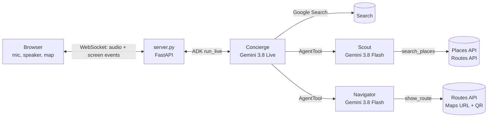

# Dinner Scout—an A4I 2026 mini-demo

A five-minute voice demo for the Agents for Impact 2026 events, run coming back from a break. You open a page and
say, out loud, *"I'm here in Toronto doing an event for Google, it's coming up on dinner time and I'm looking for
something to eat."* Dinner Scout talks back, asks a couple of questions (walk or drive, how far), and narrows it
down with you to one restaurant. You can interrupt her mid-sentence, ask whether a colleague in a wheelchair can
get in, and switch language. While she talks, the screen fills in: a Google map, restaurant cards with numbered
pins, the agents at work. It ends with the route on the map and a **QR code the room can scan** to open the
directions in Google Maps on their phones.

It's a product showcase, not an architecture lesson: Gemini Live doing a real spoken conversation, with a small
team of agents built with the Agent Development Kit (ADK) working Google Maps behind it. Nothing is staged: the
restaurants are real, near wherever the laptop is, at the moment you ask. Nothing is stored.

## Presenting it? Start here

| Read | When | What it is |
|---|---|---|
| [`STAGE.md`](STAGE.md) | First | The one-pager for the day: what you need, the morning-of steps, the break before, what to do when something goes wrong, recording the fallback video |
| [`run-of-show/docs/TELEPROMPTER - Dinner Scout.docx`](run-of-show/docs/) | On stage, second monitor | Three "before the show" pages, then one page per beat: the tab to be on, what to say to her (orange), what to say to the room (teal), what a good answer looks like, what to do if it goes wrong. Also as [`TELEPROMPTER.md`](run-of-show/docs/TELEPROMPTER.md) |
| [`run-of-show/docs/PLANNING GUIDE - Dinner Scout.docx`](run-of-show/docs/) | The night before | How it works, the setup with expected output, the talk track for each beat, a fact sheet (models, timings, what the Scout searches), things to confirm. Also as [`PLANNING-GUIDE.md`](run-of-show/docs/PLANNING-GUIDE.md) |
| [`run-of-show/PLAN.md`](run-of-show/PLAN.md) | If you want to change it | Why the demo is shaped this way |

The short version:

```bash
# Once, in Cloud Shell, in your own Google Cloud project (a lab project works):
git clone https://github.com/haggman/A4I2026-minidemo-dinner.git && cd A4I2026-minidemo-dinner
bash scripts/make_places_key.sh     # turns on Agent Platform, Places API (New), Routes API; makes the server's key
bash scripts/make_map_key.sh        # turns on the Maps JavaScript API; makes the page's map key
bash scripts/start_demo.sh          # the pre-show check (about a minute), then the page on port 8080
```

Then click the `http://0.0.0.0:8080` link it prints (it opens in Cloud Shell's Web Preview), allow the location,
press **Start**, allow the microphone, and talk. On the day: `bash scripts/start_demo.sh` in the morning,
`bash scripts/start_demo.sh --quick` at the break before you go on (Cloud Shell sleeps after 40 idle minutes),
and the fallback video open in a second Chrome tab. New keys can take a minute or two to work: if the first check
fails on Places, wait two minutes and run it again.

**The pre-show check** ends with **GO**, **GO WITH CARE** (it works, with longer pauses) or **NO-GO** (use the
video). It checks the keys, a Google Maps search, walking times, the voice's first-word time, the specialists'
speed, and then holds a whole typed conversation through the real agents, down to the QR code.

**The fallback video** is recorded on the page itself: press **Record** *before* **Start**, choose this tab,
run the demo, press **Stop recording**. The video, with both voices, lands in Downloads. Keep it on the laptop:
if the wifi fails, Cloud Shell goes with it.

**Things that help in a room:** a handheld or lapel mic (laptop speakers feeding the laptop mic make her
interrupt herself; **Hold to talk** is the backup), and Location Services on for Chrome so the map starts at the
venue. The box at the bottom of the page takes typed turns, for rehearsal.

## What's on the screen

| Where | What it shows |
|---|---|
| Top left | Where you are ("Near …", named from the browser's location) and the local time; chips for what she's learned (on foot, up to 15 min, when) |
| The map | A Google map with you, numbered pins for the cards, and at the end the route to your pick |
| Top right | The orb (lights up as she speaks), Start / Stop |
| Who's working | Three panels, Concierge, Scout and Navigator, each lighting up with a one-line status while it works |
| Captions | The last few lines from you and from her; "(interrupted)" when you cut her off |
| Cards | Up to six restaurants: photo (with its author), rating, price, walk or drive minutes, open now, wheelchair access. The cards she names light up green |
| Your pick | At the end, the column becomes the chosen place with its QR code |
| Bottom | Hold to talk, the First word timer, Record, and the typed box |

## How it works



| Agent | Model | Its job | Its tools |
|---|---|---|---|
| **Concierge** | Gemini 3.8 Live (Agent Platform, `us`) | The only one that talks. Holds the conversation and your preferences, answers "is it a chain?" itself, hands work to the other two and keeps you company while they run | `note_preferences`, Google Search, the Scout, the Navigator |
| **Scout** | Gemini 3.8 Flash, thinking LOW | Finds restaurants near you and reports them in card order | `search_places` (Places API text search, Routes API walking or driving times) |
| **Navigator** | Gemini 3.8 Flash, thinking LOW | Turns the pick into a route on the map and a QR code | `show_route` (Routes API line, a Google Maps directions link) |

The browser talks only to our server: mic audio up (16 kHz), her voice down (24 kHz), and small JSON events that
draw the screen. Gemini runs on Google Cloud's Gemini Enterprise Agent Platform with Cloud Shell's own credentials,
so there is no Gemini key. The two
Maps keys are the only keys: the server's for Places and Routes, and the page's for the map, locked to Cloud
Shell and localhost.

## A quick tour of the code

If there's time for two minutes in the code, these are the pieces worth opening, in this order:

1. **The team**: [`dinner_scout/agents.py`](dinner_scout/agents.py). `build_concierge()` at the bottom puts the
   three agents together: the Scout and the Navigator are wrapped as `AgentTool`s with
   `response_scheduling = WHEN_IDLE`, which is what lets her keep talking while they work. `PERSONA` is her
   instructions in plain English: ask one question at a time, never read more than three places, name only
   the Scout's places, say a sentence before every hand-off. `build_scout()` and `build_navigator()` show how
   small a specialist is.
2. **The tools**: [`dinner_scout/tools.py`](dinner_scout/tools.py). Each tool does real work *and* updates the
   screen. `search_places()` calls Places, filters by real walking time from the Routes API, numbers the cards,
   and sends them to the page before the Scout has even answered. `note_preferences()` is how "I'll be in New
   York next week" moves the map. `show_route()` draws the route and makes the QR code.
3. **The voice loop**: [`dinner_scout/server.py`](dinner_scout/server.py). `ws_endpoint()` starts an ADK live
   session per page; `upstream()` feeds mic audio into it; `downstream()` turns what comes back into audio for
   the speaker and events for the screen. `NUDGE` is the one line the server says to her if she hands off to the
   Scout in silence.
4. **Google Maps**: [`dinner_scout/places.py`](dinner_scout/places.py) (`DINNER_FIELDS` is the field mask: we
   ask for exactly what the cards show, and no reviews), [`dinner_scout/routes.py`](dinner_scout/routes.py)
   (walking and driving times, the route line), [`dinner_scout/maps_links.py`](dinner_scout/maps_links.py) (the
   directions link and its QR code; no key needed).
5. **The page**: [`static/index.html`](static/index.html), one file. Worth a look: the `Mic` AudioWorklet
   (resamples the mic to 16 kHz), `play()` (queues her voice), `handle()` (every screen event), `spotlight()`
   (lights up the cards she names), `toggleRecord()` (the fallback recorder).

Two settings files: [`demo.env`](demo.env) (models, where they run, search radius, the fallback landmark per city)
and `keys.env` (the two Maps keys, made by the scripts, never committed).

## What's here

| Path | What it is |
|---|---|
| `STAGE.md` | The one-pager for presenting it |
| `run-of-show/` | The teleprompter and planning guide (Word and Markdown), built from `run-of-show/src/content.js`; rebuild with `cd run-of-show && npm install && bash src/build.sh` |
| `scripts/start_demo.sh` | The start block: the pre-show check, then the page in the background (`--quick`, `--city Atlanta`, `--stop`) |
| `scripts/preshow_check.py` | The pre-show check on its own |
| `scripts/make_places_key.sh`, `scripts/make_map_key.sh` | Turn on the APIs and make the two Maps keys, once per project |
| `scripts/activate.sh`, `scripts/run.sh` | The Python environment; the page alone, in the foreground, without the check |
| `dinner_scout/` | The agents, tools, server and Google Maps calls (see the tour above) |
| `static/index.html` | The page |
| `demo.env` | Settings you might change |
| `tests/offline_harness.py` | Scripted stand-ins for Gemini and Google Maps drive the real server end to end; no Google calls, no keys |
| `tests/serve_offline.py` | The page with those stand-ins, for trying the layout without keys |
| `probe/` | The probes that settled the design (below) |

**What it logs:** the server writes what she heard and said, what was on screen and what the Scout reported to
`~/.a4i-dinner/server.log` in your Cloud Shell, which is overwritten at each start. Handy when something looks
wrong (`tail -f ~/.a4i-dinner/server.log`); delete it if a volunteer from the audience spoke.

**What it costs:** each search is one Places text search plus one Routes call, and each conversation uses Gemini
Live and a few short Gemini Flash calls, all billed to the project you run it in. A rehearsal is a handful of
each.

## How the design was settled

`probe/probe.py`, `probe/deadair.py` and `probe/where_is_live.py` were run in a lab project on 2026-10-09:

- Gemini 3.8 Live on Agent Platform answers from the `us` multi-region (and `us-central1`), not from `global`.
- Left alone, the voice goes silent while a specialist works. It now says a sentence before a hand-off and keeps
  you company while the Scout searches; the server nudges it if it hands off in silence. Worst silence in the
  best run: 4.2 s, down from 9 to 14 s.
- `note_preferences` must be an ordinary tool: scheduled SILENT, it could leave the voice silent for good.
- The specialists think at LOW (gemini-3.8-flash rejects MINIMAL) and answer tersely: the Scout went from 10 s
  to 3.6 s.
- Google Search on the Concierge answers "is it a chain, is it loud" in about 2 s, so there is no separate
  search agent.

The first full run-through in a fresh lab project (2026-10-12): first audio 0.65 s, first word in conversation
1.5 s, cards on screen 5.2 s after the first question, route and QR code 5.8 s after the pick.

If Agent Platform won't serve the Live model to a project, a Gemini API key is the fallback: create one in Google
AI Studio (**Get API key**), put it in `keys.env` as `GOOGLE_API_KEY`, and set `A4I_BACKEND=gemini-api` in
`demo.env`.

## Licence

Apache 2.0; see `LICENSE` and `NOTICE`. Place details come from Google Maps Platform at run time under its own
terms, and none are stored in this repository.
